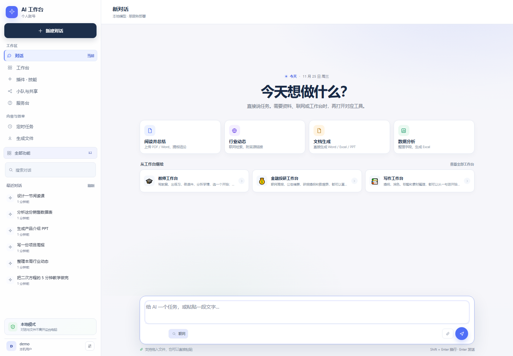

# 本地 AI 工作台

一个跑在自己电脑或 NAS 上的 AI 工作台。FastAPI 单服务，浏览器即界面；对话、资料、账号和生成文件都留在本机，模型通过本地 llama.cpp / Ollama / LM Studio / vLLM 接入，也兼容任何 OpenAI 接口。



## 为什么是它

- **本地优先**：默认只监听局域网，数据存 SQLite，不需要云账号。
- **一个服务**：用户端、管理控制台、OpenAI 兼容 API 共用 `9100` 端口。
- **模型自由**：本机 llama.cpp，或局域网里的 Ollama、LM Studio、vLLM、自定义 OpenAI 兼容服务。
- **开箱即用**：Windows 双击 `start.bat`；macOS / Linux 执行 `./start.sh`；NAS 用 Docker Compose。
- **功能完整**：不是聊天壳子，资料库、长期记忆、定时任务、文档生成、多机算力池、用户组与配额、内容安全、备份恢复都在。

## 功能一览

| 模块 | 能做什么 |
| --- | --- |
| 对话 | 流式输出、多轮上下文、停止/重试、附件、Markdown、代码块 |
| 工作台 | 教师、金融、写作等模板；自定义工作台；从一句话生成结构化结果 |
| 资料库 | 上传 PDF / Word / Excel / PPT / 文本，本机解析、检索、引用 |
| 长期记忆 | 默认关闭，用户可自行开启；每个账号独立，管理员可审计 |
| 定时任务 | 按 cron 规则执行，可联网检索，结果回到会话和通知中心 |
| 文档生成 | 把回答直接导出为 Word、Excel、PPT、PDF、Markdown、TXT |
| 多机算力池 | 把多台机器上的模型服务编成一个池，按模型名路由 |
| 组织与权限 | 用户组、管理员角色、用量配额、API Key、调用审计 |
| 内容安全 | 本地规则 + 可选模型复核，命中后拦截并记录 |
| 外观 | 品牌名、Logo、登录页文案、备案信息，控制台实时预览 |
| 运维 | 数据库迁移、备份/恢复、日志、健康检查、内网穿透入口 |
| API | `/v1/chat/completions`、`/v1/models`，可直接给第三方客户端用 |

更细的说明见 [功能介绍](docs/features.md)。

## 三分钟启动

### Windows

要求：Windows 10/11，Python 3.10–3.12（推荐 3.12）。

1. 解压到一个普通目录，例如 `D:\LocalAI\workbench`，不要放 `Program Files`。
2. 双击 `start.bat`。首次会自动建 `.venv`、装依赖、后台启动并打开浏览器。
3. 打开 `http://127.0.0.1:9100/`，按页面提示初始化管理员。
4. 管理控制台：`http://127.0.0.1:9100/console/`。

停止用 `stop.bat`，重启用 `restart.bat`。端口可改：`start.bat --Port 9200`。

### macOS

要求：macOS 12+，Python 3.10–3.12（`brew install python@3.12`）。

```bash
cd local-ai-workbench
chmod +x start.sh
./start.sh
```

也可以双击 `start-macos.command`。后台运行日志在 `data/logs/`，停止执行 `./stop.sh`。

### Linux

要求：Python 3.10–3.12、`python3-venv`。

```bash
cd local-ai-workbench
chmod +x start.sh
./start.sh
```

要开机自启，用 [systemd 安装说明](docs/install-linux.md)。

### Docker / NAS

```bash
docker compose up -d
```

默认映射 `9100:9100`，数据落在 `./data`。群晖、威联通、Unraid、TrueNAS 的图文步骤见 [NAS 安装说明](docs/install-nas.md)。

## 接一个模型

工作台本身不下载模型。先让本机或局域网里有一个 OpenAI 兼容服务，再在控制台「部署」或「供应商」里接入。

最省事的是 Ollama：

```bash
ollama pull qwen2.5:7b
ollama serve
```

然后在控制台「供应商」新建：

- Base URL：`http://127.0.0.1:11434/v1`
- API Key：留空
- 模型名：`qwen2.5:7b`

也可以让工作台管理 llama.cpp：控制台「部署」页选择平台，一键检测、安装、加载 GGUF 模型。模型文件不打进仓库，放在 `models/` 或任意目录，在设置里指过去即可。

## 目录结构

```text
local-ai-workbench/
├── backend/                 FastAPI、SQLite、业务服务、管理控制台
├── frontend/                用户端静态页面
├── tests/                   pytest 回归测试
├── deploy/                  systemd / launchd 模板
├── scripts/                 安装与运维脚本
├── docs/                    安装、功能、架构、安全说明
├── data/                    运行时数据（不入库）
├── models/                  模型目录（不入库）
├── run.py                   服务入口
├── start.* / stop.*         各平台启停脚本
├── Dockerfile
└── docker-compose.yml
```

## 配置

优先级：环境变量 > `data/config.json` > 代码默认值。

| 变量 | 说明 | 默认 |
| --- | --- | --- |
| `WORKBENCH_DATA` | 数据目录 | `./data` |
| `WORKBENCH_MODELS` | 模型目录 | `./models` |
| `WORKBENCH_LLAMA` | llama.cpp 目录 | `./llama` |
| `WORKBENCH_SECRET` | 密钥加密主密钥 | 自动生成 `data/secret.key` |
| `PORT` | 启动脚本监听端口 | `9100` |
| `HOST` | 启动脚本监听地址 | `0.0.0.0` |

常用配置项：`host`、`port`、`models_dir`、`llama_dir`、`upstream_base`、`upstream_key`、`ctx`、`threads`、`gpu_layers`、`system_prompt`、`github_proxy`。

> `data/secret.key` 用于加密供应商 Key，**必须和数据库一起备份**。丢失后已保存的 Key 无法解密。

## 安全与隐私

- 首次启动没有默认密码，必须由本机初始化管理员。
- 会话 Cookie 为 HttpOnly；写操作带 CSRF 校验；登录有限流。
- 供应商 Key 使用 AES-256-GCM 加密后入库。
- 默认关闭知识库、长期记忆、总资料库等会扩大数据面的功能，管理员按需开启。
- 公网暴露前请阅读 [安全部署](docs/security.md)：改强密码、开 HTTPS、限制注册、配置反向代理和防火墙。
- 仓库不包含任何真实对话、账号、密钥、模型或本机绝对路径。

## 开发与测试

```bash
python -m venv .venv
.venv/bin/pip install -r requirements.txt
.venv/bin/python -m pytest -q
```

Windows 把 `.venv/bin/` 换成 `.venv\Scripts\`。

测试使用临时数据目录，不会碰 `data/`。

## 文档

- [功能介绍](docs/features.md)
- [Windows 安装](docs/install-windows.md)
- [macOS 安装](docs/install-macos.md)
- [Linux / systemd](docs/install-linux.md)
- [NAS / Docker](docs/install-nas.md)
- [模型接入](docs/models.md)
- [架构说明](docs/architecture.md)
- [安全部署](docs/security.md)
- [常见问题](docs/faq.md)

## 许可证

MIT。见 [LICENSE](LICENSE)。
