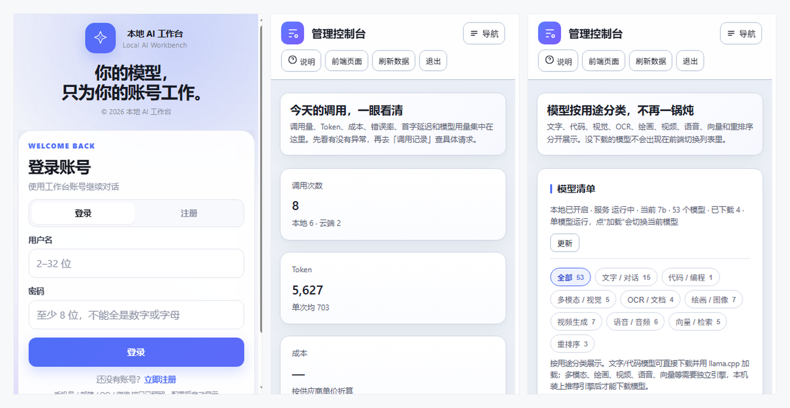
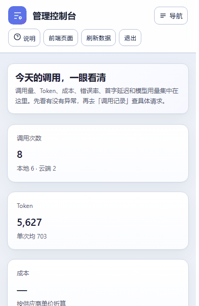

# 本地 AI 工作台

> 当前版本 **0.8.6.0** · MIT · Docker 镜像与发布记录见 [Releases](https://github.com/shishuihanbei/local-ai-workbench/releases)

单进程部署：FastAPI 后端 + 用户前端 + 管理控制台 + OpenAI 兼容 API。模型在本机运行，对话记录存本机 SQLite，不经过云端。



三个界面从左到右：用户端登录与对话、控制台运行观测、模型清单（本地 53 个模型按用途分类，下载与加载状态实时可见）。

- **本地模型托管是后台一等公民**：下载、加载、切换保护、中断续传、下载进度、引擎检测都在控制台完成，不依赖 Ollama 外挂；装了外部平台也能自动读 `/v1/models` 并接入。
- **给团队用的治理**：用户 / 部门 / 管理员角色权限 / 每人每日每月 Token 配额 / 公开与小队对话分享 / 操作审计 / 内容安全，都在同一套后台里。
- **一键起步**：Windows 双击 `start.bat`，NAS 上 `docker compose up -d`，首次启动自动初始化管理员，不用先装 Python 再配环境。

控制台六个面板的巡览（约 12 秒，真实截图，非演示动画）：



```
工作台
├── 用户端        http://127.0.0.1:9100/
├── 管理控制台    http://127.0.0.1:9100/console/
├── API           http://127.0.0.1:9100/v1
└── 健康检查      http://127.0.0.1:9100/api/health
```

## 文档

- [架构与开发手册](docs/architecture-handbook.md)：现状测绘、开发流程、技术债与重构路线（接手开发先读这篇）
- [架构速览](docs/architecture.md)

## 目录

```
workbench/
├── backend/
│   ├── main.py              应用入口、静态托管、安全响应头
│   ├── db.py                SQLite 建表、迁移、外键约束
│   ├── security.py          口令哈希、会话、CSRF、限流、权限
│   ├── routers/             auth / branding / users / chat / models / kb / memory / ops / system / admin / apikeys / openai_api / database / cluster / collab
│   ├── services/            llama、TTS、隧道、知识库、长期记忆、调用观测、密钥加密、API Key、登录方式、数据库中心、多机算力池、内容安全、协作套件、品牌外观、开机自启、桌面图标
│   └── console/             管理控制台
├── frontend/
│   ├── index.html           用户端：登录/注册/对话/设置
│   ├── core/auth/models/skills/…/*.js  12 个域脚本（见手册 4.1）
│   ├── app.css / app.ui.css
│   └── favicon.svg
├── data/
│   ├── workbench.db         账号、会话、消息、调用记录、API Key、第三方身份
│   ├── config.json          端口、上游地址、模型目录等
│   ├── auth_providers.json  QQ/微信/手机号/邮箱登录配置（默认关闭）
│   ├── database_connections.json  外部数据库连接（密码加密）
│   ├── database_migrations.json   最近迁移记录
│   ├── database_backups/    数据库快照与 SQL/CSV 导出
│   ├── secret.key           供应商 Key 加密主密钥（务必随库备份）
│   └── logs/  audio/  uploads/
├── run.py                   uvicorn 启动入口
├── start.ps1 / stop.ps1 / restart.ps1
├── start.bat / stop.bat / restart.bat
├── start.sh / stop.sh / restart.sh
├── requirements.txt / requirements-ocr.txt
└── README.md
```

模型放在程序根目录的 `models`，下载的部署平台统一放在 `platforms`：`platforms/llama.cpp`、`platforms/ollama`（Ollama 的模型也在 `platforms/ollama/models`），下载的安装包缓存在 `platforms/.downloads`；安装后自动创建，可在控制台「部署 · 存储位置」改成别的目录，不写死绝对路径。整个 `platforms` 文件夹可以整体搬走。

## 快速开始

Windows 双击 `start.bat`。首次会自动建虚拟环境、安装依赖、后台启动，不弹黑窗口。

> Python 要求 3.10–3.12，推荐 3.12。启动脚本会自动寻找 3.12；如果已有 `.venv` 是 3.13 以上，会自动改名保留并用 3.12 重建。图片/扫描件 OCR 是可选组件，装不上也不影响聊天和资料库启动，只会暂不识别图片文字。

首次使用：

1. 打开 `http://127.0.0.1:9100/`。
2. 数据库还没有账号时，页面显示“初始化管理员”，设置管理员账号密码。
3. 管理员登录后可在 `http://127.0.0.1:9100/console/` 管理用户、模型、供应商、路由和网络。
4. 已开启自助注册时，其他使用者在用户端点“注册”，注册后直接进入对话。

命令行：

```powershell
.\start.ps1              # 后台启动并打开用户端
.\start.ps1 -NoBrowser   # 不打开浏览器
.\start.ps1 -Foreground  # 前台运行，便于看日志
.\stop.ps1               # 停止
.\restart.ps1            # 重启
```

Linux / macOS：

```bash
./start.sh
./stop.sh
./restart.sh
```

### Docker / NAS

已发布多架构镜像（`linux/amd64` + `linux/arm64`），不用本地构建：

```bash
docker run -d --name local-ai-workbench -p 9100:9100 \
  -v "$PWD/data:/data" -e WORKBENCH_SERVE_FRONTEND=1 \
  --restart unless-stopped \
  ghcr.io/shishuihanbei/local-ai-workbench:latest
```

在仓库目录也可以直接 `docker compose up -d`，compose 已带数据卷、模型卷、健康检查和 `WORKBENCH_SERVE_FRONTEND=1`。

- 镜像不含模型，首次启动后在控制台「模型」页下载；`/models` 挂到宿主目录可复用已有 GGUF。
- `data/` 必须挂到持久目录并纳入备份，`secret.key` 与 `workbench.db` 一起保留，否则已加密的供应商 Key 无法解密。
- 多个容器或副本共用一份 `data` 时，显式给同一个 `WORKBENCH_SECRET`。
- 镜像标签随每次发布打 `v<版本号>` 和 `latest`，版本说明见 [Releases](https://github.com/shishuihanbei/local-ai-workbench/releases)。

默认监听 `0.0.0.0:9100`。本机 `127.0.0.1:9100`，局域网 `http://<本机IP>:9100/`。启动脚本会把用户端、控制台和局域网地址一起打印出来。

### 桌面图标（一个就够）

正式安装（`data` 在程序目录下）首次启动时，会给装系统的那台机器放**一个**桌面图标：**双击进后台**（管理控制台）；**右键菜单**里有「打开前台 / 打开后台」两项。

- Windows 生成 `AI 工作台.wbapp`，并在 `HKCU\Software\Classes` 注册 `AIWorkbench.App` 类型：图标用 `data/branding/workbench.ico`，默认动词是「打开后台」，另外注册了「打开前台」。双击/右键都走根目录的 `open.ps1`。注册表被策略禁用时退回一个 `AI 工作台.url`。
- `open.ps1` 先探 `/api/health`：服务没起就静默拉起再打开浏览器，所以关了机、关了服务，双击一样能用；服务在跑就直接开页面。
- Linux 生成 `AI 工作台.desktop`（`Exec` 指向 `open.sh`），带 `Actions=Front;Console;`，右键同样可选前后台，并复制到 `~/.local/share/applications`；macOS 生成 `AI 工作台.webloc`（默认进后台）。
- **打开哪个地址可以选，默认走局域网**：控制台「部署 · 桌面图标」里切换「本机 127.0.0.1 / 局域网 IP / 自定义（穿透或反代后的 https）」。默认是局域网，没手动指定 IP 时按本机网卡自动探测；选择存在 `config.json` 的 `shortcut_mode` / `shortcut_lan_ip` / `shortcut_custom_url`，启动器每次双击时读取，改完不用重建图标。控制台顶栏的「前端页面」按钮也跟随这个地址偏好：在本机打开控制台时默认跳到局域网地址，已经用局域网或域名访问的则沿用当前地址。
- 容器、NAS 或没有图形桌面的纯服务器不建图标，直接在浏览器收藏前台和后台地址；Docker 重启策略用 `restart: unless-stopped`。
- 「管理控制台 · 部署」页有「创建桌面图标 / 删除桌面图标」，随时可补一个或撤掉。开机自启在同一页，按钮开的是系统级自启（Windows 启动项、Linux systemd/cron、macOS LaunchAgent），和桌面图标互不影响。

## 用户端

用户端按“左侧历史栏 + 主对话区”布局，手机和桌面自适应。

- **登录 / 注册 / 首次初始化**：同一个页面，按数据库状态自动切换。登录态使用 HttpOnly 会话 Cookie + CSRF Token，不把 Bearer Token 放 localStorage。
- **对话地址**：打开某段对话后地址栏变成 `/chat/<对话ID>`，刷新、收藏或从历史记录直接打开都会回到同一段对话；浏览器前进/后退也会跟随切换。新对话仍显示根地址 `/`，发出第一条消息拿到 ID 后自动更新。
- **对话**：新建、搜索、打开、重命名、删除会话；流式输出；停止生成；重新生成；复制回复；Markdown 渲染；推理过程折叠；知识库命中标签。
- **工作台与定时任务**：左侧栏直接列出「工作台 / 插件 · 技能 / 小队与共享 / 服务台」，不用翻到会话列表底部。工作台面板分「概览 / 定时任务 / 技能与插件 / 生成文件」；「插件 · 技能」侧栏入口会一键打开能力中心，标题和说明自动切成「技能与插件」。概览顶部有模板横幅和 9 个推荐工作台：教师、金融投研、营销、创意设计、写作、正式材料、新媒体、医生、游戏；每个模板自带多个技能和插件，卡片与横幅会显示「技能 · xx / xx / xx」「插件 · xx」。点「使用」会先回到新对话，并进入该工作台的专属首页：角色化欢迎语、当前技能/插件和 8 个推荐任务，推荐任务会自动同步技能、联网/知识库与 Word/Excel/PPT 输出格式。工作台横幅也会显示该模板的欢迎语、说明和图标，默认启用第一个技能，横幅上的其余技能可随时点选切换，右侧可一键退出当前工作台，同时同步联网与知识库；每张卡直接露出「使用 / 自定义 / 分享」。当前使用的工作台按账号保存在服务端，不会串到其他用户；侧栏「新建对话」下方会显示当前工作台和关闭按钮，关闭后清空当前工作台及其技能/插件状态。顶部还有「新建工作台」；自定义可以改名称、图标、说明、技能（可多选）、默认插件和 8 个快捷按钮，保存后归到自己名下，原推荐模板不受影响。点「分享」会生成 `/wb/<token>` 链接，分享页会展示技能与插件，对方可以查看并用「导入到我的工作台」一键保存成自己的自定义工作台；链接可设 7 天、30 天或永久。能力中心用渐变横幅汇总当前技能和插件，下面按「回答技能 / 插件能力」分区；技能卡片和插件开关都直接可点，联网、知识库、文档生成三个插件状态立即生效。概览还显示对话数、文件数、启用任务数、近 24 小时运行次数，以及接下来要执行的任务、最近文件和最近对话。定时任务页有「为你推荐」8 个常用任务，点 + 会自动填好名称、提示词、执行频率和联网开关，创建前仍可修改。任务支持只执行一次、每天、每周（可多选星期）、每月，选择时间、模型、智能体和输出格式，也可勾选联网检索；到点后服务端自动新建一个会话执行，结果和普通聊天一样保留，如果选了 Word/Excel/PPT/PDF 还会生成可下载文件。支持立即执行、暂停/启用、编辑、删除和查看上次结果，运行完成会在用户端提示并更新最近对话。
- **文件输出**：输入框「自动」下拉可选 Word / Excel / PPT / PDF / Markdown / 纯文本。选定后，回答不再只是在聊天里贴正文，服务端会把完整内容排成真实文件（Word 为 A4、宋体小四、1.5 倍行距、首行缩进、标题层级、表格、代码块和页码；Excel 自动分工作表、表头样式、筛选和冻结；PPT 自动分页；PDF 用 A4 中文排版并加页码），聊天中直接出现带下载按钮的文件卡片。文件落库到 `data/exports`，下载走 `/api/files/generated/{id}`，有登录与归属校验；历史消息重新打开后文件卡片仍在。生成文件只保留标题和正文，不再插入“本地 AI 工作台 · 生成于 …”的品牌与时间落款；Word 页脚保留页码。生成文件默认保留 30 天，到期后自动删除物理文件；聊天文件卡片、工作台「生成文件」和概览最近文件都会显示有效期和剩余天数，3 天内变为橙色提醒，已清理的文件不再提供下载入口。管理员可在后台「备份迁移」页把保留周期改为 1–365 天，保存后立即按新周期重算并清理。没有选格式时，消息里出现“写/生成/整理/上传 word、excel、ppt、pdf”等明确动作也会自动识别。
- **附件**：输入框左侧上传图片、文本、PDF、Word、Excel、PPT 等文件，也可以直接粘贴截图；单文件上限 20MB、一条消息最多 5 个；文本和文档会在服务端提取正文并跟随对话上下文，图片会做 OCR 提取文字，扫描版 PDF 会逐页渲染后 OCR。图片始终保留原文件预览。识别为空或内容不理想时，管理员可在后台「解析」页直接重跑，不用让用户重新上传。
- **技能**：输入框左侧选择总结提炼、翻译、润色改写、代码助手、文件问答、方案规划；技能提示词由服务端注入，只作用于下一条消息。
- **联网**：输入框左侧“联网”按钮默认关闭。开启后，服务端先做查询规划：附件/资料库总结和日常追问跳过联网，新闻类自动改写为“日期 + 新闻联播 + 主要内容”并抓取央视当日条目，普通问题去掉“帮我/查一下”等指令词。检索优先 360 HTML（中文命中更好），Bing RSS 兜底，只保留相关来源并抓取前两页正文。回复下方显示实际检索词和来源；跳过或检索失败都会明确提示，不会伪造来源。附件只有一个在线文档链接且正文需要登录时，会按文档标题检索公开同主题资料，并在回复开头注明“并非原文档”。
- **后台联网**：管理控制台「联网」页提供总开关、结果条数（1–10）和正文抓取页数（0–4），保存后立即生效并清空检索缓存。关闭总开关时，用户端联网按钮和定时任务都会跳过检索，回复里明确写“管理后台已关闭联网检索”，不会假装查过。页内还能直接输入查询跑真实检索，显示耗时、实际检索词和来源列表，方便验证当前网络和解析线路。
- **后台附件解析**：管理控制台「解析」页列出全部上传记录，按文件名、上传者、正文状态筛选，显示字数、解析时间、耗时和报错原因；支持查看完整正文、下载原件、单条重新解析、勾选批量重解析，以及一键重跑所有空正文。OCR 引擎状态、扫描 PDF 页数上限和文档图片上限也在页内说明。任务在后台串行执行，避免多张图片同时 OCR 打满 CPU；页面用进度条显示当前文件、成功/空正文/失败数量和总耗时，完成后自动刷新列表。
- **模型**：模型下拉框紧挨发送按钮；只显示已下载完成的本地模型，未下载、下载中的模型不会出现在下拉框；普通用户只能看到管理员分配的模型。
- **账号设置**：头像/角色、账号 ID、最近登录、登录 IP；修改密码；查看登录设备并“退出其他设备”；退出登录。
- **API 设置**：自动判断本机 / 内网 / 外网，给出推荐 Base、局域网地址和外网地址；生成、查看、撤销 API Key；Key 明文只显示一次；内置 curl / Python 示例。
- **对话设置**：默认模型、温度、最大输出 Token、知识库开关、系统提示词；当前会话的系统提示词可直接保存到该会话，新会话使用默认值。
- **我的知识库**：用户自己上传或粘贴资料，只保存到个人库，只用于自己的对话检索，不影响公共库和其他账号。个人知识库开关默认关闭；开启后可用两个复选项决定对话时参考「公共知识库」还是「我的个人知识库」，公共项受管理员总开关限制。支持查看篇数/字数、关键词检索、重命名接口、二次确认删除和 JSON 导出，每人上限 200 篇。
- **我的资料库**：与知识库独立，专门放可反复选用的资料。个人资料库默认关闭；开启后可用「总资料库」「我的个人资料」两个复选项决定聊天时可选的来源，两个来源可同时勾选。聊天输入框新增「资料库」按钮，可按标题筛选、多选资料（单次上限由管理员设置），选中的资料随每条消息反复带入，并记录引用次数和最近使用时间。用户可以批量上传、粘贴、检索、查看正文、删除自己的个人资料；上传支持 txt/md/csv/json/pdf/docx/xlsx/xlsm/xls/pptx 和 png/jpg 等图片，单文件上限 20MB。图片与扫描版 PDF 通过本地 OCR 转成正文，扫描件默认识别前 15 页；聊天框中上传的可读文件会自动存入个人资料库，同名同字数不重复添加，OCR 后仍无正文则跳过。总库资料只能由管理员维护，普通用户不能删除。每人最多 100 篇个人资料。资料可设置文件夹（80 字以内）和最多 12 个标签（逗号/分号/顿号分隔均可），列表和检索支持按文件夹、标签筛选；每篇可随时「整理」改标题和分类。聊天附件自动入库默认归入文件夹「聊天上传」并打同名标签。
- **我的记忆**：用户自己开关长期记忆、查看自己的条目、手动添加和删除；默认关闭，关闭后不影响已有条目；管理员总开关未打开时会明确提示暂不参与对话。
- **外观**：浅色 / 深色 / 跟随系统，正文字号 85%–125%，只保存在本机浏览器。
- **数据**：导出全部对话 JSON；清空全部对话（二次确认）；迁移和安全说明。

`allow_register` 默认在 `data/config.json` 开启。关闭后用户端不再显示注册入口，但已有账号仍可登录。管理员也可在控制台「用户」页勾选“允许访客自助注册”。

## 登录方式

前期默认启用「用户名 + 密码」，登录页和注册页默认就是这一套。手机号、邮箱、QQ、微信在控制台「登录方式」页按需开启，未配置时不会出现在登录页。

手机号/邮箱启用后，用户端登录页会自动出现「手机号 / 邮箱」切换按钮：输入号码或地址、获取 6 位验证码，即可登录；管理员开放注册时，同一入口也能直接注册并自动绑定该手机号/邮箱。已登录用户可以在「设置 → 账号」中绑定更多登录方式。

| 方式 | 当前状态 | 接口 |
| --- | --- | --- |
| 用户名 | 默认可用 | `POST /api/auth/register`、`POST /api/auth/login` |
| QQ | 填 QQ 互联凭据后启用，支持扫码登录 | `GET /api/auth/oauth/qq/start`、`GET /api/auth/oauth/qq/callback` |
| 微信 | 填微信开放平台凭据后启用，支持扫码登录 | `GET /api/auth/oauth/wechat/start`、`GET /api/auth/oauth/wechat/callback` |
| 手机号 | 支持验证码发送、登录、注册、绑定 | `POST /api/auth/otp/send`、`POST /api/auth/otp/login`、`POST /api/auth/otp/register` |
| 邮箱 | 支持验证码发送、登录、注册、绑定 | 同上，`channel=email` |

第三方身份统一写入 `auth_identities` 表，一个 `users.id` 可以绑定多条身份；QQ/微信按 openid/unionid 映射，手机号按号码映射，邮箱按小写地址映射。

### 控制台「登录方式」页

管理员登录控制台后，进入「登录方式」即可配置：

- QQ / 微信：AppID、AppSecret、回调地址，附开放平台注册教程和回调地址提示。
- 手机号：可选阿里云短信、腾讯云短信、云片网、自定义 HTTP 短信接口；填密钥、签名、模板编号或自定义请求模板，支持直接发测试短信。
- 邮箱：可选 QQ 邮箱、网易 163、Gmail、阿里云邮件推送、腾讯云邮件推送、SendGrid、Mailgun、Outlook / Microsoft 365、Amazon SES、Postmark、Resend、自定义 SMTP；支持直接发测试邮件。不在列表里的服务商，选最后一项“自定义 / 其他 SMTP”即可。
- 每个登录方式有独立“启用”开关，状态会显示“已启用 / 配置不完整 / 未启用”。
- 密钥字段只保存在本机 `data/auth_providers.json`，页面不回显原文；保存时留空表示不修改。
- 验证码 5 分钟有效，同一手机号/邮箱 60 秒内只能发一次、1 小时最多 5 次。

也可以直接编辑 `data/auth_providers.json`：

```json
{
  "qq": {"enabled": true, "client_id": "...", "client_secret": "...",
         "redirect_uri": "https://你的域名/api/auth/oauth/qq/callback"},
  "phone": {"enabled": true, "sms_vendor": "aliyun", "sms_key": "...",
            "sms_secret": "...", "sms_sign": "签名", "sms_template": "SMS_..."},
  "email": {"enabled": true, "smtp_vendor": "qq", "smtp_host": "smtp.qq.com",
            "smtp_port": 465, "smtp_ssl": true, "smtp_user": "...",
            "smtp_password": "授权码", "smtp_from": "..."}
}
```

- QQ 互联后台的回调地址必须与 `redirect_uri` 完全一致；微信开放平台同样要求域名备案和 HTTPS。
- 也支持环境变量：`WORKBENCH_QQ_CLIENT_ID`、`WORKBENCH_QQ_CLIENT_SECRET`、`WORKBENCH_QQ_REDIRECT_URI`、`WORKBENCH_WECHAT_APP_ID`、`WORKBENCH_WECHAT_APP_SECRET`、`WORKBENCH_WECHAT_REDIRECT_URI`，以及 `WORKBENCH_PHONE_*`、`WORKBENCH_EMAIL_*`；环境变量优先于文件。
- OAuth 首次登录只有在 `allow_register=true` 且已有管理员时才会自动建号；否则会提示“尚未绑定，请先用用户名登录”。
- 手机号/邮箱可以给当前账号绑定：`POST /api/auth/identities/bind`；QQ/微信的绑定入口后续接入。


## 长期记忆（默认关闭，用户可自己开）

对话默认只带本次会话的最近 20 条消息，不跨对话记忆。管理员保留总开关，普通用户可以在用户端「设置 → 记忆」自己打开或关闭：

- **两层开关**：管理员总开关关闭时所有人都不使用；总开关打开后，每个用户自己的开关默认关闭，想跨对话记忆才自己打开。
- **关闭时**：不写入新记忆，也不会把旧记忆带进对话；已有条目保留。
- **打开后**：用户说“我叫…”“我是…”“我喜欢…”“以后都…”“记住…”这类明确自述，会按账号存进 `memories` 表；每条回复最多挑 6 条相关记忆注入，占用约 1,200 字以内。
- **按账号隔离**：一个账号的记忆不会出现在另一个账号的对话里；用户端只能查看、添加和删除自己的条目。
- **可纠正**：控制台和用户端都能看到来源（自动 / 手动）、命中次数和更新时间；删除后下一轮立即生效。
- **不抢推理资源**：自动记忆只做规则抽取，不调用模型；不额外启动推理任务。
- 关闭记忆不会清空数据；单个账号超过 40 条时，优先淘汰权重最低、最久未更新的条目。

管理接口：`GET /api/admin/memory`、`POST /api/admin/memory/toggle`、`POST/PATCH/DELETE /api/admin/memory/items[/{id}]`（仅管理员）。

用户自助接口：`GET /api/my/memory`、`POST /api/my/memory/toggle`、`POST/PATCH/DELETE /api/my/memory/items[/{id}]`、`POST /api/my/memory/clear`（当前登录账号，服务端强制按 `user_id` 过滤）。

## 管理控制台

`/console/` 29 个功能页。左侧按「运行观测 / 用户与组织 / 模型与能力 / 内容与访问 / 接入与运行 / 系统与数据」六组导航，顶部提供页面搜索；窄屏下收纳为可开合的导航抽屉。每个页面顶部统一使用紧凑白底标题，只保留标题和一句用途说明，不再用大块渐变头图、装饰标签和示意图占首屏。

- **概览**：请求量、Token、成本、延迟分位、逐小时趋势、模型用量。
- **调用记录**：按供应商/模型/状态筛选；关键词可搜 prompt、trace_id、用户名、会话 ID 或会话名称（ID 支持 `#123`），列表直接显示用户和会话编号+名称（超长名称省略，悬停看全名）；单条明细含完整 Prompt、参数、路由决策、Span、TTFT、Token。
- **供应商**：内置常见第三方 API 预设，选择后自动填名称、Base URL 和推荐模型，字段仍可修改；也支持“自定义 / 其他 OpenAI 兼容接口”。支持测试和删除，Key 以 AES-256-GCM 加密落库，列表只显示掩码。
- **路由**：本地模型与第三方 API 的混合路由规则；供应商下拉按「本地部署 / 云端供应商」分组，表格直接显示供应商名称；选择云端后可点“自动匹配”，按 deepseek / qwen / llama 等模型家族生成映射，未匹配项会提示手动补。
- **外观**：集中维护用户端 Logo、品牌名称/简称/副标题、品牌主色、登录页大标题与说明、登录卡片副标题、登录页脚文案、页脚版权、ICP 备案和公安备案。右侧实时预览，改字即可看到效果。Logo 支持 PNG / JPG / WebP / GIF（最大 3 MB），上传后立即生效，删除则恢复默认 SVG；备案链接只接受 http/https。企业档案（域名、行业、规模、联系人）折叠在同页，另有全局安全水印，支持 `{user}`、`{org}`、`{date}` 占位符，登录后覆盖用户端和控制台页面。
- **内容安全**：独立页签，管理敏感词词库、输入/输出检测策略和命中记录。词库支持分类、备注、启停、单个新增和批量粘贴（逗号、分号、换行均可分隔），重复词自动跳过。用户输入在发给模型前检测，模型输出在返回前检测；动作可选 **拦截**（输入直接返回 400，输出终止并提示）、**替换**（按设置的字符替换敏感词后继续）或 **仅告警**（只记录不改变内容）。流式输出会保留跨块尾巴，避免敏感词被拆到两个 chunk 绕过；聊天接口和 OpenAI 兼容接口的非流式、池非流式、直连流式、池流式四条路径都接入。命中记录显示时间、账号、方向、动作、命中词、片段和模型，可按输入/输出筛选和清空。检测默认关闭，开启后立即对新请求生效。
- **智能体**：维护人格化角色目录。每个智能体包含名称、头像、说明、系统提示词、推荐模型、公开 / 仅小队 / 私有可见范围和启停排序；用户端选中后，服务端会把角色提示词注入本轮对话，并在可用时优先使用推荐模型。公开智能体所有成员可用，小队智能体只对绑定小队的成员可见。
- **伙伴**：组织成员目录的只读视图，汇总账号、用户组、管理员角色、最近登录、所属小队数量；成员的新增、停用和配额仍在「用户」页维护。
- **小队**：把成员、智能体和共享对话组织到一起。所有者可以加人、绑定智能体、把成员自己的对话共享到小队；成员只能读取已共享到本小队的会话，看不到别人的全部对话。小队详情直接展示成员、智能体和共享对话。
- **公告**：全员公告支持级别（通知 / 提醒 / 重要）、置顶和启停；启用的公告显示在用户端顶部，置顶优先，可单条关闭。
- **服务台**：用户从用户端提交工单，管理员按状态、优先级和关键词筛选，打开工单查看完整消息，回复并分派处理人，状态支持待处理 / 处理中 / 已解决 / 已关闭。
- **对话分享**：把当前对话生成只读快照链接，支持公开或仅小队可见、最长 365 天有效期和随时撤销；已分享内容不会随后续聊天变化，可在控制台统一查看浏览量和撤销。
- **用户**：新建/编辑/禁用/删除账号；给每个用户单独分配模型；开关注册；查看和踢掉登录会话。**部门 / 用户组**支持上级部门、负责人和排序，形成部门树，删除部门会把成员改为未分组并把下级提为顶层。管理员角色可给角色为 admin 的账号绑定细粒度权限，按概览、外观、内容安全、智能体、伙伴、小队、公告、服务台、对话分享、调用、用户、登录方式、供应商、路由、API、网络、部署、算力、模型、知识库、资料库、记忆、备份、审计、数据库、网站分享、提示词、前台功能、技能等模块逐项勾选；未绑定角色的管理员仍是拥有全部权限的超级管理员，避免升级后锁死。**Token 配额**按每用户每日/每月上限在聊天和 OpenAI 兼容接口入口拦截，额度为 0 表示不限，管理员默认跳过；用户列表实时显示今日/本月已用和上限。**批量导入**支持粘贴 CSV/TSV 账号清单并指定默认部门、角色和配额，**导出 CSV**用于备份成员名册，不包含密码。
- **前台功能**：独立页签统一控制用户端入口显隐，按「对话增强 / 资料与记忆 / 效率工具 / 协作与接入」分成 15 个开关，基础对话、登录、历史、模型切换、账号与主题固定显示。联网、知识库、资料库、记忆复用原能力总开关；其余开关只隐藏入口，不删数据、不改权限。工作台关闭时，定时任务和生成文件自动隐藏并锁定；右侧实时预览侧栏、输入框工具条和设置页，先改预览、保存后统一下发。每个功能图标支持预设图标、图标库上传（PNG/JPEG/WebP/SVG，≤160KB）和低饱和底色；用户端刷新、切回页面或 60 秒轮询修订号后自动同步，不需要重启服务。
- **提示词中心**：把运行时提示词统一注册成资产，按核心、技能、功能、输出格式、工作台和智能体分类展示。基础人格、6 个内置技能、10 条功能规则、6 种输出格式和 9 个工作台模板集中编辑；内置资产保存后标记“已覆盖默认”，可恢复默认；每次保存或恢复都会生成版本并提升修订号。保存后进程缓存立即失效，多进程按 `settings.prompt_rev` 最多 1.2 秒内对齐，**下一条消息生效，不需要重启服务**。页面顶部显示真实拼装顺序，底部可带知识库、资料库、记忆、联网和输出格式做拼装预览；智能体提示词只读展示并跳转智能体页维护；工作台模板支持结构化编辑欢迎语和 8 条推荐任务。核心提示词保存时同步写回 `config.json` 的 `system_prompt`。数据库不可用或种子失败时回退代码内置默认值。
- **技能**：内置总结、翻译、润色、代码、文件问答、方案规划六个技能，默认值可在「提示词中心」覆盖和启停，也能一键恢复默认；管理员可新建自定义技能，设置名称、说明、图标、提示词、排序和启停。自定义技能写入 `custom_skills` 表，启用后立即出现在用户端技能菜单，选中时由服务端把提示词追加到本轮系统提示；停用后新消息不可选，已有对话记录不受影响。
- **登录方式**：QQ、微信、手机号、邮箱的独立开关与配置；手机号内置阿里云/腾讯云/云片/自定义 HTTP，邮箱内置 QQ/163/Gmail/阿里云/腾讯云/SendGrid/Mailgun/Outlook/Amazon SES/Postmark/Resend/自定义 SMTP；带接入教程和发送测试。
- **API**：判断本机/内网/外网，生成和撤销用户 API Key，展示 curl / Python 示例。
- **网络**：保存本地前端地址并一键跳转；内网穿透默认免费临时地址，目标可选管理控制台、模型 API 或本地前端；启动/停止、下载组件、查看日志；固定域名放在进阶区。启动失败时页面直接显示原因，Cloudflare 返回 `429` 会提示临时隧道被限流，预检失败会提示 7844/UDP/TCP 被拦，避免只显示“未开启”。
- **部署**：检测硬件、llama.cpp 安装状态；每张平台卡有独立的“一键部署”按钮，勾选只负责启用平台。已安装的平台自动跳过下载，直接启动或连接；未安装则自动安装。**Ollama 装的是便携版**：下载官方 `ollama-windows-amd64.zip`（Linux `ollama-linux-amd64.tgz`，macOS `Ollama-darwin.zip`）解压到 `platforms/ollama`，启动时用 `OLLAMA_MODELS=platforms/ollama/models` 把模型也收在同一目录，不写系统目录、不注册服务，新的机器上不会再出现“装到 `%LOCALAPPDATA%\Programs\Ollama` 找不着”的情况。卡片上直接列出**程序目录 / 模型目录**并支持一键复制；已经用官方安装包装在系统目录的，卡片会多一个“装到工作台目录”（`?force=1` 重装便携版）和一个“迁移旧模型”（把 `~/.ollama/models` 的 blobs/manifests 搬进 `platforms/ollama/models`，同盘是秒级改名）。**顺序很重要**：先在托盘图标里 Quit 掉系统版 Ollama（否则 11434 被它占着，工作台只会提示“先退出它”），再点“装到工作台目录”，装好后点“迁移旧模型”把原来的模型搬过去。llama.cpp 装完会用已下载的 GGUF 自动启动，没有模型时引导去「模型」页。GitHub 打不开时自动在直连和 gh-proxy / ghfast / ghproxy 加速之间回退，并优先使用诊断出的最快线路；右上角“网络诊断”并行检查 GitHub、PyPI、Ollama 和 LM Studio 官网；完全离线时，可把 llama.cpp 压缩包或 `ollama-windows-amd64.zip` 放进 `data/installers/` 作为离线包。底部“部署已选平台”可批量执行，“保存选择”只保存勾选、地址和 GitHub 加速设置。关闭本地部署后，用户端不再出现本地模型，API 也会拒绝本地模型调用，已配置第三方供应商时自动改用云端。已勾选且健康的外部平台会自动读取 `/v1/models`，把可用模型直接加到用户端模型下拉；切换这类模型不会启动 llama.cpp，聊天请求直接路由到对应平台服务。

- **模型**：模型清单按用途分为文字/对话、代码/编程、多模态/视觉、OCR/文档、绘画/图像、视频生成、语音/音频、向量/检索、重排序九类，内置 52 个常见模型条目；带分类筛选、下载、加载；下载过程在状态列显示实时进度，按钮同时变为「下载中…」并禁用（不再出现“点了没反应”），进程重启等原因中断后显示「已中断 X%」并可点「继续下载」接着 `.part` 续传；页头“更新”会把内置清单里缺失的模型补回来，并发现模型目录里尚未登记的新 GGUF；已有模型和用户修改不会被覆盖。文字和代码 GGUF 可直接下载；多模态、OCR、绘画、视频、语音、向量等条目显示“推荐引擎”，并实时检测本机是否安装 Transformers、vLLM、Diffusers、PaddleOCR、FunASR 等独立引擎。引擎未安装时下载按钮置灰；装好后可一键把 Hugging Face 整仓库拉到 `<模型目录>/<模型 key>`，下载完成后才会标记为已下载。页底「独立引擎清单」逐个给出官网、下载地址、安装命令，能 pip 安装的直接提供“一键安装”并在卡片内显示进度；vLLM 在 Windows 上标记为需 WSL2/Linux，ComfyUI、Fish Speech、Ollama 标记为手动部署。默认走 `hf-mirror.com`，可用 `hf_endpoint` / `WORKBENCH_HF_ENDPOINT` 改回官方站，gated 模型可用 `hf_token` / `HF_TOKEN`。注意：独立引擎下载完成只代表模型文件已就位；Transformers/Diffusers/ComfyUI 等仓库模型不会被工作台自动启动成聊天服务，需要先由对应运行时或外部 OpenAI 兼容服务加载并暴露 `/v1/models`，健康平台上的模型才会自动进入前端切换列表。本机 llama.cpp 一次只加载一个权重，切换必须重启进程；所以别人正在生成回答时切换会先弹窗，可选择“等它说完”（结束后自动切换，期间对方不被打断）、“强制切换”（立即中断）或取消。`/api/models/in-use` 返回当前被谁、被几个会话占用。
- **并发与数据库**：聊天生成受全局并发上限约束（默认同时 4 路），超出先排队等待、排队超时返回 429 提示；并按账号做每分钟发送条数限流（默认 30 条/分钟），避免单人刷屏挤占名额。数据库访问层常驻一条共享 SQLite 连接、由异步锁串行化，不再每个请求新建连接和后台线程。并发与限流可用配置 `chat_max_active`、`chat_rpm`，或环境变量 `WORKBENCH_CHAT_MAX_ACTIVE`、`WORKBENCH_CHAT_RPM` 调整。
- **知识库**：管理员在这里统一管理公共库和所有用户的个人库。公共知识库检索默认关闭，可在「公共知识库检索」面板开启或关闭；开启后用户还要在自己的知识库设置里勾选「公共知识库」才会引用。控制台显示全部/公共/个人数量和字符总量；列表按「全部库 / 公共库 / 个人库」和账号筛选，显示归属账号、库类型、来源、字数；可直接查看正文、删除用户个人文档。公共库仍只有管理员能写；个人库由用户自己开关。管理员上传公共文件或添加文本后，页面内会显示“上传完成/已添加”的绿色提示。检索测试覆盖全部库并标出归属。备份会导出公共+个人文档及归属，恢复时个人文档回到原账号，同名跳过。文档保存在本机 SQLite，不随网站分享包导出。
- **资料库（管理）**：与知识库并列的独立页签，共用文档存储但按 `module='library'` 隔离。总库开关默认关闭；管理员可启停、设置单次最多选几篇和最多带入多少字，上传/粘贴总库资料、查看全部总库与用户个人资料、按库类型和账号筛选、查看正文、删除任意资料、导出/恢复独立资料库备份。列表显示引用次数和最近使用时间。上传支持 txt/md/csv/json/pdf/docx/xlsx/xlsm/xls/pptx 和 png/jpg 等图片，单文件上限 20MB；图片与扫描版 PDF 会本地 OCR；聊天附件中的可读文件会自动进入对应用户的个人资料库。资料可设置文件夹和标签，列表支持按文件夹、标签筛选并可在行内「整理」；导出恢复会保留分类。
- **长期记忆**：默认关闭，只使用会话内上下文；一键启用后按账号保存自述和偏好，跨对话按相关度注入。页面含总开关、统计、账号筛选、手动添加和删除，自动抽取只存明确原句，不调用模型。
- **备份迁移**：独立页面，提供一键备份、一键生成整机迁移包、上传恢复；列出最近备份，可下载或删除；迁移包默认保存到 `data/migrations/`，页面内显示路径，不再使用弹窗确认。
- **审计日志**：独立只读页，显示管理员操作的全量留痕：时间、账号、动作、目标、详情、IP 和状态；支持按关键词、动作前缀、成功/失败和最近 1/7/30 天筛选与分页。登录、用户、模型、知识库、资料库、数据库、技能、算力池等管理动作都会记录到 `audit_logs`。
- **数据库中心**：浏览当前 SQLite 的表、字段、索引和外键，支持关键词搜索、排序、分页、单行新增/编辑/删除、CSV 导出、SQL 控制台（默认只读）、健康检查、VACUUM 和一致性快照。健康检查会逐条列出断裂外键的表名、行号和父表；发现孤儿记录时可一键清理（清理前自动生成一份快照）。可添加本机或远程 MySQL / MariaDB、PostgreSQL、外部 SQLite 连接，密码加密保存；连接串可直接粘贴解析。支持把当前数据一键复制到目标库，逐表校验行数。**工作台主库仍是本地 SQLite**，外部库用于扩容、备份和管理，不会在断网时拖垮整个服务。
- **网站分享**：独立页面，生成不含任何数据的干净程序包，保存到 `data/shares/`；对方解压后双击「一键开始-双击我.bat」，首次启动重新初始化管理员、用户、模型和供应商。

### 自定义 OpenAI 兼容

部署页的“自定义 OpenAI 兼容”不是安装器，而是**外部服务接入 + 连通性测试**入口。它只做三件事：保存服务地址、探测 `GET /v1/models`、告诉你连没连上；不会替用户安装 Ollama、vLLM 之类的软件。

接入顺序：

1. **先启动外部服务**：Ollama、LM Studio、vLLM、llama.cpp server，或任意第三方 OpenAI 兼容 API。
2. **部署页填服务根地址并测试**：例如 Ollama 填 `http://127.0.0.1:11434`，点“测试连接”，成功显示“连接正常 · N 个模型”。
3. **点“保存选择”**：只测试不保存，刷新后地址会丢。
4. **供应商页新建供应商**：预设选“自定义 / 其他 OpenAI 兼容接口”。Base URL 要带 `/v1`，例如 `http://127.0.0.1:11434/v1`；本机服务 Key 可留空；模型名必须和 `/v1/models` 返回的 `id` 完全一致。
5. **路由页绑定**：新建策略并选这个供应商；需要网页聊天也走它时，在模型映射里把工作台模型名映射到对方的模型名。
6. **前端实测**：发一句“你好”，能在调用记录里看到这个供应商即成功。

地址对照：

| 服务 | 部署页“服务地址” | 供应商页“Base URL” | 模型名示例 |
| --- | --- | --- | --- |
| Ollama | `http://127.0.0.1:11434` | `http://127.0.0.1:11434/v1` | `qwen2.5:7b` |
| LM Studio | `http://127.0.0.1:1234` | `http://127.0.0.1:1234/v1` | LM Studio 显示的模型名 |
| vLLM | `http://127.0.0.1:8000` | `http://127.0.0.1:8000/v1` | `Qwen/Qwen2.5-7B-Instruct` |
| llama.cpp server | `http://127.0.0.1:8080` | `http://127.0.0.1:8080/v1` | 启动时加载的模型名 |
| 第三方 API | 服务商文档的根地址 | 文档里的 Base URL，通常以 `/v1` 结尾 | `deepseek-chat` |

本机最省事的安装方式是 Ollama：在部署页点 Ollama 卡的“一键部署”，程序会解压到 `platforms/ollama`，再执行 `ollama pull qwen2.5:7b`（工作台拉起的服务已经把 `OLLAMA_MODELS` 指向 `platforms/ollama/models`），浏览器打开 `http://127.0.0.1:11434/v1/models` 能看到 JSON 即可。LM Studio 则是下载模型后在 Developer 页点 `Start Server`，默认端口 `1234`。vLLM 适合 Linux + NVIDIA 或 WSL2，执行 `vllm serve Qwen/Qwen2.5-7B-Instruct --host 0.0.0.0 --port 8000`。

### 模型到底怎么进到工作台下拉里

这是新手最容易卡住的一环，逻辑其实只有一句：**下拉里的模型 = 勾选并连通的平台 `/v1/models` 里返回的 id**。

- **不需要先装 llama.cpp**。llama.cpp 只是四种本地引擎之一；只装 Ollama（或只用 LM Studio、vLLM、自定义 OpenAI 兼容）也能正常聊天，模型照样出现在下拉里。
- **Ollama 的模型在哪**：便携版在 `platforms/ollama/models`（`blobs/` 放权重，`manifests/` 放名字标签）。用自己终端 `ollama pull` 时如果要用同一目录，先设环境变量 `OLLAMA_MODELS=<程序目录>\platforms\ollama\models`；已经在 `~/.ollama/models` 的，在部署卡片点“迁移旧模型”搬过来。
- **怎么让它出现**：`ollama pull` 完成后，部署页点“更新”→ 勾选 Ollama → “保存选择”。之后用户端「模型」下拉就会列出这些模型，聊天请求直接发给 `http://127.0.0.1:11434/v1`（工作台会自动补 `/v1`），不走 llama.cpp。
- **看不到模型时排查**：① Ollama 卡片是不是“已连接”；② 地址是不是根地址（`http://127.0.0.1:11434`，不要带 `/v1`）；③ 没有勾选并保存；④ 浏览器直接打开 `http://127.0.0.1:11434/v1/models` 看有没有返回模型。
- **切换模型**：选 Ollama 的模型不会启动/重启 llama.cpp，也不会弹出“等它说完”，因为推理在 Ollama 进程里跑，工作台只做路由。

### 模型从哪下：按引擎分开，不是一条统一的直链

同一个权重在不同引擎里是**不同格式**，所以没有一个“通用下载地址”，界面按引擎分别给安装方式：

- **llama.cpp → GGUF 直链**：模型页行内的“下载”按清单里的仓库 + 文件名，从 HuggingFace / ModelScope 拉单个 `.gguf` 到 `models_dir`，下载完点“加载”由 llama.cpp 起服务。
- **Ollama → registry tag**：`ollama pull <tag>`（例如 `qwen2.5:7b`、`deepseek-r1:7b`），落到 Ollama 自己的模型目录（便携版是 `platforms/ollama/models`，`blobs/` 存权重、`manifests/` 存 tag）。模型页顶部有“从 Ollama 拉取模型”的输入框，可以填任意 tag；内置清单里能对上的常见模型，行内会直接出现「用 Ollama 拉取」按钮（标签映射见 `backend/ollama_tags.py`）。
- **vLLM / SGLang / ComfyUI 等独立引擎 → 整仓库下载**：先把推荐引擎装上（`engine_ready`），再点“下载”把整个 HF 仓库拉到自己的目录。

**装了多个平台怎么办**：各装各的，互不覆盖——Ollama 存 blobs、llama.cpp 存 `.gguf`，格式不能互换，也不能把 Ollama 的模型塞给 llama.cpp。界面上每行都标着引擎和对应来源；最终用户在「模型」下拉里看到哪些，取决于部署页**勾选并连通**了哪个平台，工作台只做路由。

### 卸载平台：删程序、保模型

部署卡片上“启动/一键部署”旁边多了「卸载」，只对**工作台自己装的**平台出现（`platforms/ollama` 的便携版、`platforms/llama.cpp`）：

- **卸载时**：先停掉工作台拉起的进程（Ollama 的 `serve`、llama-server），释放 11434 / 8080 端口；再删 `platforms/<key>` 里的程序和 `lib`、`platforms/.downloads` 里这个平台的便携包；完成后回报释放了多少空间，卡片回到“可部署”。
- **保留**：你自己 pull 的模型（`platforms/ollama/models`）和 `data/installers` 里的安装包都不动，重装后直接能用。
- **拒绝的情况**：系统安装的 Ollama / LM Studio（工作台没装东西，去 Windows「设置 → 应用」卸）；Ollama 端口被托盘里的另一个进程占着（先在托盘右键 Quit，再点卸载）。
- 接口：`POST /api/system/local-platforms/{key}/uninstall`；Ollama 拉模型是 `POST /api/system/local-platforms/ollama/pull`（`{"tag": "qwen2.5:7b"}`）+ `GET` 同路径查进度。

部署页只描述**本机实际装了的引擎**：没装 llama.cpp 就不会出现“llama.cpp 状态”这一块，装了 Ollama 就在“本地部署开关”和“服务”里显示 Ollama 的地址与运行状态——部署几个写几个，不拿 llama.cpp 当默认前提。

### 登录页记住账号

用户端和控制台登录页都有“记住账号/记住用户名”勾选框，默认勾上，只把用户名存在浏览器 `localStorage`（`wb_last_username`、`wb_console_username`），不存密码；取消勾选会清掉本机记录。控制台只有在**首次初始化**（数据库里还没有管理员）时才预填 `admin` 并明确提示“这就是即将创建的第一个管理员，可以改名”，初始化之后再打开登录页输入框是空的、只回填上次登录的用户名。

### 从用户端点进管理控制台不用再登录

`/` 和 `/console/` 是同一个站点、同一份会话 cookie，所以用户端右上角那个「控制台」按钮（在侧栏底部、和用户名同一行，只有管理员可见）点进去是**直接进后台**，不会再弹一次登录页。控制台启动时先问 `/api/auth/me` 判定身份：cookie 有效且角色是管理员就进主界面；会话失效或当前账号不是管理员才显示登录页，后者会明说“当前账号「xxx」不是管理员，请用管理员账号登录”。登出会同时结束 cookie 会话，用户端也会一起退出。

最常见的错误是 Base URL 少写或多写 `/v1`：部署页填根地址，供应商页填带 `/v1` 的 Base URL。远程服务器还要把 `127.0.0.1` 换成对方 IP，并让服务监听 `0.0.0.0`、放行防火墙端口。控制台部署页内已提供完整的六步接入、四种安装方案和错误排查表。

每个页面顶部统一使用紧凑标题，只保留“这页解决什么问题”和一句用途说明；原来的大块渐变头图、装饰标签和示意图已移除，首屏直接进入操作区。29 个页面现在都有完整说明：顶部「说明」按钮随时打开当前页的功能清单、操作步骤、实战案例和注意事项；没有现成说明面板的页面，会在底部自动挂载「使用说明」摘要和「详细说明」入口，不需要逐页手写。

## 多机算力池

控制台「算力」页把多台局域网机器上的**同一个模型**合成一个统一模型名。它做的是**副本池**：每台机器各自完整加载模型，工作台只负责把请求分给当前最空闲的一台。单次请求仍然只在一台机器上算，不会把模型分层切到多台机器。

这样能合并的是**并发和吞吐**，不是单次请求的速度。三台 8G 显存的机器各跑一份 q4 量化模型，可以同时服务三个人；不会因为三台机器合起来就把 70B 模型跑起来。

**接入步骤**

1. 每台机器先用 Ollama / LM Studio / vLLM / llama.cpp 起一个 OpenAI 兼容服务，确认 `GET /v1/models` 能返回模型。
2. 控制台「算力」页 → 节点 → 填机器名和地址，例如 `http://192.168.5.40:11434/v1`。
3. 保存后工作台会探测一次；状态变为“在线”并读到模型列表。
4. 新建模型池，填统一模型名，例如 `qwen3-8b-pool`，把节点逐个加为成员，填每台机器上的真实模型名。
5. 调用时模型名填池名；地址仍是 `http://127.0.0.1:9100/v1`，API Key 用「API」页生成的用户 Key。

**调度规则**

- 加权最少连接：按 `当前并发 / 权重` 排序，越闲越优先；成员权重和节点权重相乘。
- 轮询：按成员顺序轮流。
- 在线节点优先，未检查节点次之，离线节点最后尝试。
- 非流式和流式都支持故障转移；流式只在**还没有吐出第一个字**之前换机器，已经开始输出后中断不会重试，避免把半句话接到另一台机器。
- 健康检查默认每 30 秒探测一次 `/v1/models`，也可以在页面点“检查全部”。

**和「自定义 OpenAI 兼容」的区别**

「自定义 OpenAI 兼容」只保存**一个** Base URL，适合单台 Ollama / LM Studio / vLLM 或第三方 API；它不能把多台机器合成一个模型。多机算力池保存**一组**节点，对外暴露一个池名，能合并并发并在节点故障时自动切换。

真正的分布式推理（张量并行、流水线并行、层切分）需要同构硬件、低延迟网络和专用推理框架；家用 Wi-Fi 下通常比单机更慢，本工作台不做这件事。

## 数据库中心

控制台「数据库」页面向不熟悉数据库的使用者，把常用操作集中在一处：

- **数据浏览**：左侧表清单，右侧分页表格；按文本字段搜索、按列排序、查看完整单元格；行内编辑/删除，新增行；查看字段类型、是否可空、默认值、主键、索引、外键和建表 SQL；单表导出 CSV。
- **表管理**：图形化新建表（表名、字段名、类型、主键、自增、可空），重命名表、清空表数据、删除整张表；删除和清空前必须输入完整表名，并会自动生成一份 SQLite 快照；工作台运行依赖的核心表禁止改名或删除，避免误操作把控制台弄坏。
- **SQL 控制台**：单条 SQL，默认只读（SELECT / WITH / SHOW / EXPLAIN）；开启“允许写操作”后仍需二次确认；显示耗时、影响行数、`last_id` 和截断提示。
- **外部连接**：支持 MySQL / MariaDB、PostgreSQL 和外部 SQLite 文件；可填主机、端口、库名、账号、SSL，或粘贴 `mysql://`、`postgresql://`、`sqlite:///` 连接串自动解析；密码用本机密钥加密保存，接口只返回“是否已设置”，不回显明文；可测试连接、浏览、编辑和删除记录。
- **一键迁移**：把当前工作台数据完整复制到目标库，自动建库/建表、分批复制数据、创建索引与外键、逐表校验行数，并提供进度、日志和最近迁移记录。目标有同名表时必须显式勾选覆盖；迁移前可先检查冲突。
- **备份与维护**：下载 SQLite 一致性快照、导出 MySQL / PostgreSQL 方言 SQL 脚本、健康检查、VACUUM 回收空闲页。

边界：迁移是“复制到目标库并继续管理”，不会把工作台运行时主库切到 MySQL / PostgreSQL；`kb_fts` 全文检索虚拟表只随 SQLite 快照保留，不复制到 MySQL / PostgreSQL。连接记录在 `data/database_connections.json`，迁移历史在 `data/database_migrations.json`，数据库快照和导出文件在 `data/database_backups/`。

## API 使用

在用户端「设置 → API」生成 Key。Base URL 自动按当前访问方式给出：

- 本机：`http://127.0.0.1:9100/v1`
- 内网：`http://<本机IP>:9100/v1`
- 外网：先在控制台「网络」页开启穿透，目标选“管理控制台”，再使用 `https://<临时域名>/v1`

```bash
curl "http://127.0.0.1:9100/v1/chat/completions" \
  -H "Authorization: Bearer sk-wb-..." \
  -H "Content-Type: application/json" \
  -d '{"model":"7b","messages":[{"role":"user","content":"你好"}],"stream":false}'
```

- `GET /v1/models`：当前 Key 可用的模型。
- `POST /v1/chat/completions`：兼容 OpenAI，支持 `stream: true`。
- Key 只保存 SHA-256 哈希，明文只在生成时显示一次；继承所属用户的模型权限；撤销、用户禁用或删除后立即失效。
- 管理员在控制台关闭本地部署后，`/v1/models` 不再列出本地模型；请求本地模型返回 `503 / local_disabled`。若配置了第三方供应商，未指定模型时会自动改用云端。

## 配置

`data/config.json` 常用字段：

| 字段 | 说明 |
| --- | --- |
| `host` / `port` | 监听地址与端口，默认 `0.0.0.0:9100` |
| `upstream_base` | 本地模型服务地址，默认 `http://127.0.0.1:8080/v1` |
| `upstream_key` | 本地模型服务密钥 |
| `model` | 默认模型标识 |
| `local_enabled` | 本地部署总开关，`false` 时用户端与 API 都不再使用本地模型 |
| `deploy_platforms` | 部署平台多选：`llama.cpp` / `ollama` / `vllm` / `lmstudio` / `custom`；空或未选默认 `llama.cpp` |
| `platform_endpoints` | 外部平台根地址，如 `http://127.0.0.1:11434`，不要带 `/v1` |
| `github_proxy` | GitHub 下载线路：`auto` 自动选最快镜像，`off` 只直连，或填自定义加速前缀 |
| `ctx` / `threads` | 上下文长度与线程数 |
| `models_dir` | 模型目录，默认程序根目录下的 `models`，可在控制台「部署 · 存储位置」修改 |
| `platforms_dir` | 下载的部署平台目录，默认程序根目录下的 `platforms` |
| `llama_dir` | llama.cpp 目录，默认 `<platforms_dir>/llama.cpp` |
| `WORKBENCH_OLLAMA_DIR`（环境变量） | Ollama 便携版目录，默认 `<platforms_dir>/ollama`；不写进 config.json，始终跟着 `platforms_dir` 走 |
| `WORKBENCH_OLLAMA_MODELS`（环境变量） | Ollama 模型目录，默认 `<ollama_dir>/models`，启动时作为 `OLLAMA_MODELS` 传给 `ollama serve` |
| `hf_endpoint` | Hugging Face 下载站，默认 `https://hf-mirror.com`；想用官方站就改成 `https://huggingface.co` |
| `hf_token` | 可选，下载需要授权的 gated 模型时填 Hugging Face 令牌 |
| `serve_frontend` | 是否由本进程同时托管用户端（单进程模式），默认 `false`；启动脚本和 docker-compose 会把它打开，前后端分离部署时保持关闭 |
| `allow_register` | 是否允许访客自助注册，默认 `true` |
| `brand_logo` | `data/branding/` 下的 Logo 文件名，由控制台「外观」上传/删除 |
| `brand_tagline` / `brand_primary` | 品牌副标题与主色（十六进制），主色会覆盖用户端 `--brand` 主题色 |
| `brand_login_title` / `brand_login_lead` / `brand_login_foot` | 登录页大标题、说明和页脚文案，支持换行 |
| `brand_auth_subtitle` | 登录卡片副标题 |
| `brand_icp` / `brand_icp_url` | ICP 备案号与链接，链接留空使用官方查询入口 |
| `brand_police` / `brand_police_url` | 公安备案号与链接 |
| `brand_copyright` | 页脚版权；留空自动生成 `© 年份 + 品牌名称` |
| `websearch_enabled` | 联网检索总开关，默认 `true`；关闭后用户端和定时任务都跳过检索 |
| `websearch_max_sources` | 单次最多保留的来源条数，默认 `5`，范围 1–10 |
| `websearch_max_pages` | 最多抓取几篇网页正文，默认 `2`，范围 0–4 |
| `cors_origins` | 允许跨域的前端来源，逗号分隔；空值表示只允许同源。默认不再使用 `*` |
| `tunnel_target` | 穿透目标：`panel` / `api` / `frontend` |
| `tunnel_domain` | 固定域名（可选） |

环境变量：`WORKBENCH_DATA`、`WORKBENCH_PORT`、`WORKBENCH_HOST`、`WORKBENCH_SERVE_FRONTEND`。

登录渠道单独放在 `data/auth_providers.json`，不写入 `config.json`；迁移时和 `workbench.db`、`secret.key` 一起复制。

## 主要接口

| 方法 | 路径 | 说明 |
| --- | --- | --- |
| GET | `/api/health` | 健康检查（无需登录） |
| GET | `/api/meta` | 版本、运行模式、功能开关 |
| GET | `/api/front/features` | 当前用户可见的前台功能与图标（无需额外权限，需登录） |
| GET/PUT | `/api/admin/front-features` | 读取 / 保存前台功能开关与图标（管理员） |
| GET/POST | `/api/admin/front-icons` | 图标库列表 / 上传自定义图标（管理员） |
| DELETE | `/api/admin/front-icons/{id}` | 删除自定义图标并回退引用功能（管理员） |
| GET | `/api/auth/state` | 是否已初始化、是否允许注册、当前用户 |
| POST | `/api/auth/setup` | 首次初始化管理员 |
| POST | `/api/auth/register` | 自助注册（需开启 allow_register） |
| POST | `/api/auth/login` | 登录 |
| GET | `/api/auth/providers` | 登录方式状态（无需登录） |
| GET | `/api/auth/identities` | 当前账号已绑定的登录方式 |
| GET | `/api/auth/oauth/{provider}/start` | 发起 QQ / 微信授权 |
| GET | `/api/auth/oauth/{provider}/callback` | QQ / 微信授权回调 |
| POST | `/api/auth/otp/send` | 手机号 / 邮箱验证码发送 |
| POST | `/api/auth/otp/login` | 手机号 / 邮箱验证码登录 |
| POST | `/api/auth/otp/register` | 手机号 / 邮箱验证码注册 |
| POST | `/api/auth/identities/bind` | 给当前账号绑定手机号 / 邮箱 |
| POST | `/api/auth/logout` | 退出当前设备 |
| GET | `/api/auth/me` | 当前用户 |
| POST | `/api/auth/password` | 修改密码（撤销其他设备） |
| GET | `/api/auth/sessions` | 当前账号的登录设备 |
| POST | `/api/auth/sessions/revoke-others` | 退出其他设备 |
| GET | `/api/auth/export` | 导出当前用户全部对话 |
| GET | `/api/models` | 可用模型 |
| POST | `/api/models/refresh` | 补回内置清单里缺失的模型（管理员） |
| GET/POST | `/api/chat/conversations` | 会话列表 / 新建 |
| PATCH/DELETE | `/api/chat/conversations/{id}` | 重命名、改系统提示词 / 删除 |
| POST | `/api/chat/conversations/clear-all` | 清空当前用户全部对话 |
| GET | `/api/chat/skills` | 内置技能列表 |
| POST | `/api/chat/files` | 上传聊天附件并提取正文 |
| GET/DELETE | `/api/chat/files/{id}` | 预览/下载或删除附件 |
| GET | `/api/files/generated` | 当前用户生成过的文件列表 |
| GET | `/api/files/generated/{id}` | 下载生成的 Word/Excel/PPT/PDF 等文件 |
| GET | `/api/workbench/overview` | 工作台概览：计数、待执行任务、最近文件/对话/运行 |
| GET/POST | `/api/workbench/tasks` | 定时任务列表 / 新建 |
| PUT/PATCH/DELETE | `/api/workbench/tasks/{id}` | 编辑 / 启停 / 删除定时任务 |
| POST | `/api/workbench/tasks/{id}/run` | 立即执行一次定时任务 |
| GET | `/api/workbench/tasks/{id}/runs` | 某个任务的运行记录 |
| GET | `/api/workbench/runs` | 当前用户最近运行记录 |
| POST | `/api/chat/stream` | 流式对话（SSE，可选 `output_format`） |
| GET/POST | `/api/api-keys` | 列出 / 生成 API Key |
| DELETE | `/api/api-keys/{id}` | 撤销 API Key |
| GET | `/api/api-keys/context` | 判断本机/内网/外网，给出 API 地址 |
| GET/PUT | `/api/system/settings` | 系统设置（含 allow_register） |
| GET/PUT | `/api/system/websearch` | 联网总开关、结果条数、抓取页数与缓存状态（管理员） |
| POST | `/api/system/websearch/test` | 用当前配置跑一次真实检索，返回来源和耗时（管理员） |
| POST | `/api/system/websearch/cache/clear` | 清空联网检索缓存（管理员） |
| GET | `/api/admin/uploads` | 附件上传记录、解析状态、统计与 OCR 引擎状态（管理员） |
| POST | `/api/admin/uploads/reparse` | 批量或空正文重新解析；后台串行执行（管理员） |
| GET | `/api/admin/uploads/jobs/{job_id}` | 查询重新解析任务进度（管理员） |
| GET | `/api/admin/uploads/{id}/text` | 查看附件完整正文和解析信息（管理员） |
| GET | `/api/admin/uploads/{id}/file` | 下载附件原件（管理员） |
| GET | `/api/system/backup` | 新建并下载完整备份（管理员） |
| GET | `/api/system/backups` | 历史备份列表（管理员） |
| GET/DELETE | `/api/system/backups/{name}` | 下载或删除指定备份（管理员） |
| GET/POST | `/api/system/migration` | 生成整机迁移包；`?save=1` 保存到 `data/migrations/` 并返回路径（管理员） |
| POST | `/api/system/open-migration-folder` | 在运行工作台的本机打开迁移包目录（管理员，仅本机访问） |
| GET/POST | `/api/system/share` | 生成干净分享包；`?save=1` 保存到 `data/shares/` 并返回路径（管理员） |
| GET | `/api/system/shares` | 分享包列表（管理员） |
| GET/DELETE | `/api/system/shares/{name}` | 下载或删除分享包（管理员） |
| POST | `/api/system/open-share-folder` | 打开分享包目录（管理员，仅本机访问） |
| POST | `/api/system/restore` | 上传 zip 恢复备份（管理员，自动先备份当前数据） |
| GET/PUT | `/api/system/file-retention` | 查看/修改生成文档保留天数（管理员，1–365 天） |
| POST | `/api/system/file-retention/cleanup` | 立即清理已到期的生成文档（管理员） |
| GET | `/api/kb` | 全部知识库概览；`scope=all/global/personal`、`user_id`、`q` 筛选，返回公共+个人统计（管理员） |
| GET | `/api/kb/doc/{id}` | 查看单篇文档正文和归属（管理员） |
| DELETE | `/api/kb/{id}` | 删除任意公共或个人文档并清理索引（管理员） |
| GET | `/api/kb/search` | 检索公共库和所有用户个人库，结果带归属和库类型（管理员） |
| GET | `/api/kb/export` | 下载全部知识库 JSON 备份，包含公共+个人文档及归属（管理员） |
| POST | `/api/kb/restore` | 上传 JSON 追加恢复；个人文档按 `user_id` 或用户名回到原账号，同名跳过（管理员） |
| POST | `/api/kb/settings` | 开启/关闭公共知识库检索并设置每次返回段数（管理员，默认关闭） |
| GET/POST/PATCH/DELETE | `/api/my/kb`、`/api/my/kb/text`、`/api/my/kb/upload`、`/api/my/kb/{id}` | 个人知识库：概览、粘贴、上传、重命名、删除（当前账号，服务端按 user_id 隔离） |
| POST | `/api/my/kb/settings` | 个人知识库开关与来源多选：`personal_enabled`、`use_public`、`use_personal`，默认不参与对话 |
| GET | `/api/library` | 全部资料库概览；`scope=all/global/personal`、`user_id`、`q`、`folder`、`tag` 筛选，返回文件夹/标签统计、总库开关和单次上限（管理员） |
| POST | `/api/library/text`、`/api/library/upload` | 添加总库资料：粘贴文本或上传文件，可带 `folder`、`tags`（管理员） |
| PATCH | `/api/library/{id}` | 整理任意资料库文档的标题、文件夹、标签（管理员） |
| GET/DELETE | `/api/library/doc/{id}`、`/api/library/{id}` | 查看正文、删除总库或用户个人资料（管理员） |
| GET/POST | `/api/library/export`、`/api/library/restore` | 独立导出/恢复资料库备份，个人资料按原账号回填（管理员） |
| POST | `/api/library/settings` | 总库开关、单次最多篇数、最多带入字数；默认关闭（管理员） |
| GET/POST/DELETE | `/api/my/library`、`/api/my/library/text`、`/api/my/library/upload`、`/api/my/library/{id}` | 个人资料库：概览、粘贴、上传、删除（服务端只允许操作本人资料；可带 `folder`、`tags`） |
| PATCH | `/api/my/library/{id}` | 整理本人资料的标题、文件夹、标签 |
| GET | `/api/my/library/picker` | 聊天资料选择器：只返回当前用户已开启来源中获准使用的资料 |
| GET | `/api/my/library/search` | 只检索自己的个人资料库 |
| POST | `/api/my/library/settings` | 个人资料库开关与来源多选：`personal_enabled`、`use_global`、`use_personal`，默认关闭 |
| POST | `/api/chat/files` | 聊天附件上传，返回 `library` 字段说明是否已自动加入个人资料库（`added/exists/skip`） |
| GET | `/api/my/kb/search` | 只检索自己的个人知识库 |
| GET | `/api/my/kb/export` | 导出自己的个人知识库 JSON |
| GET/POST | `/api/my/memory`、`/api/my/memory/toggle` | 查看自己的记忆和开关状态、切换自己的长期记忆开关 |
| POST/PATCH/DELETE | `/api/my/memory/items`、`/api/my/memory/items/{id}` | 添加、修改、删除自己的记忆 |
| POST | `/api/my/memory/clear` | 清空自己的记忆 |
| GET/POST | `/api/system/local-deploy` | 读取 / 开启 / 关闭本地部署总开关与平台选择（管理员） |
| PUT | `/api/system/local-platforms` | 只保存部署平台、外部平台地址和 GitHub 加速设置（管理员） |
| POST | `/api/system/local-platforms/{key}/deploy` | 单平台一键部署；已安装自动跳过，`?force=1` 可强制重装（Ollama 用 `force=1` 表示“装到工作台目录”）。返回项里带 `install_path`、`models_path`、`managed`、`legacy_models_path`、`can_manage`（管理员） |
| POST | `/api/system/local-platforms/ollama/adopt-models` | 把系统目录 `~/.ollama/models` 下的 blobs/manifests 搬到 `platforms/ollama/models`（先停工作台拉起的 ollama，搬完自动重启） |
| GET | `/api/system/local-platforms/{key}/progress` | 单平台部署进度（管理员） |
| GET | `/api/system/network-check` | 并行检查 GitHub 直连/加速、PyPI 和官网（管理员） |
| GET | `/api/admin/overview` | 统计概览 |
| GET | `/api/admin/requests` | 调用记录 |
| GET/POST/PATCH/DELETE | `/api/admin/providers` | 供应商管理 |
| GET | `/api/admin/auth-providers` | 登录方式配置项、供应商预设与教程 |
| PUT | `/api/admin/auth-providers/{provider}` | 保存 QQ/微信/手机号/邮箱配置 |
| POST | `/api/admin/auth-providers/{provider}/test` | 测试短信/邮件，或检查 QQ/微信配置 |
| GET/POST/DELETE | `/api/admin/routes` | 路由规则 |
| GET | `/api/admin/audit` | 管理员操作日志，支持 q / action / status / days / limit / offset |
| GET/POST/PATCH/DELETE | `/api/admin/skills` | 自定义技能列表、新建、修改和删除 |
| GET | `/api/chat/skills` | 用户端可用技能（内置 + 已启用的自定义技能） |
| GET | `/api/admin/prompts` | 提示词资产、修订号、功能开关与拼装顺序 |
| GET/PUT | `/api/admin/prompts/{key}` | 提示词详情与保存（保存即热更新） |
| POST | `/api/admin/prompts/{key}/reset` | 恢复内置默认值 |
| GET | `/api/admin/prompts/{key}/versions` | 版本历史 |
| POST | `/api/admin/prompts/{key}/restore/{version}` | 恢复指定版本并生成新版本 |
| POST | `/api/admin/prompts/preview` | 按技能、知识库、记忆、联网和格式预览拼装 |
| POST | `/api/admin/prompts/reload` | 强制重载提示词缓存（排障用） |
| GET | `/api/workbench/catalog` | 当前生效的内置工作台模板与推荐任务 |
| GET/POST/PATCH/DELETE | `/api/users` | 用户管理（管理员），支持用户组、管理员角色和每日/每月 Token 配额 |
| GET/POST | `/api/users/groups` | 部门 / 用户组列表、新建（支持上级、负责人、排序） |
| PATCH/DELETE | `/api/users/groups/{gid}` | 修改、删除部门 / 用户组 |
| GET/POST | `/api/users/roles` | 管理员角色与权限模块，列表、新建 |
| PATCH/DELETE | `/api/users/roles/{rid}` | 修改、删除管理员角色 |
| POST | `/api/users/import` | 批量导入成员（CSV/TSV，支持表头） |
| GET | `/api/users/export` | 导出成员 CSV（不含密码） |
| GET/PUT | `/api/admin/org` | 企业档案、前端品牌、登录页文案、备案与全局水印 |
| POST/DELETE | `/api/admin/org/logo` | 上传或删除用户端 Logo（管理员） |
| GET | `/api/branding/logo` | 公开读取当前 Logo，登录页未登录也可用 |
| GET/PUT | `/api/admin/moderation` | 内容安全设置、词库与命中记录 |
| POST | `/api/admin/moderation/words` | 新增敏感词 |
| POST | `/api/admin/moderation/words/bulk` | 批量粘贴敏感词 |
| PATCH/DELETE | `/api/admin/moderation/words/{wid}` | 修改或删除敏感词 |
| DELETE | `/api/admin/moderation/hits` | 清空命中记录 |
| GET/POST/PATCH/DELETE | `/api/admin/agents` | 智能体列表、新建、修改、删除 |
| GET | `/api/admin/partners` | 组织成员目录（账号、用户组、管理员角色、最近登录、小队数量） |
| GET/POST/PATCH/DELETE | `/api/admin/squads` | 小队列表、新建、修改、删除 |
| GET/POST/DELETE | `/api/admin/squads/{sid}/members`、`/members/{uid}` | 小队成员 |
| GET/POST/DELETE | `/api/admin/squads/{sid}/agents`、`/agents/{aid}` | 小队绑定智能体 |
| GET/POST/PATCH/DELETE | `/api/admin/announcements` | 全员公告 |
| GET/PATCH | `/api/admin/tickets`、`/api/admin/tickets/{tid}` | 服务台工单列表、状态与分派 |
| POST | `/api/admin/tickets/{tid}/reply` | 管理员回复工单 |
| GET/DELETE | `/api/admin/shares`、`/api/admin/shares/{id}` | 查看和撤销全部对话分享 |
| GET | `/api/agents` | 当前用户可见的智能体 |
| GET/POST | `/api/squads` | 我的小队、创建小队 |
| GET/PATCH/DELETE | `/api/squads/{sid}` | 小队详情、修改、删除 |
| POST/DELETE | `/api/squads/{sid}/members`、`/members/{uid}` | 小队成员管理（所有者） |
| POST/DELETE | `/api/squads/{sid}/agents`、`/agents/{aid}` | 小队智能体管理（所有者） |
| POST/GET | `/api/squads/{sid}/conversations`、`/conversations/{cid}` | 共享对话到小队、只读读取 |
| GET | `/api/announcements` | 用户端已启用公告 |
| GET/POST | `/api/tickets`、`/api/tickets/{tid}` | 我的工单、提交、详情 |
| POST | `/api/tickets/{tid}/reply` | 用户补充工单 |
| POST | `/api/conversations/{cid}/share` | 生成对话快照分享 |
| GET/DELETE | `/api/shares`、`/api/shares/{id}` | 我的分享、撤销 |
| GET | `/api/shares/{token}` | 只读读取分享快照（公开或小队权限） |
| GET | `/v1/models` | OpenAI 兼容模型列表（API Key） |
| POST | `/v1/chat/completions` | OpenAI 兼容对话（API Key） |

管理接口需要管理员会话或 `Authorization: Bearer <token>`。

## 安全

- 口令使用 scrypt 哈希；登录会话 + CSRF；登录失败和注册按 IP 限流。
- 数据库连接启用 `PRAGMA foreign_keys=ON`；删除用户会级联删除会话、对话和 API Key，并先撤销所有会话。
- 普通用户只能看到并调用 `allowed_models` 里的模型；直接请求未授权模型返回 403。
- 内容安全检测默认关闭；开启后，敏感词命中会按策略拦截、替换或仅告警，并写入 `moderation_hits`。词库和命中记录只存本机 SQLite，不随网站分享包导出。
- 智能体提示词只由服务端注入；私有智能体仅所有者可用，小队智能体只对绑定小队的成员可见。对话分享保存的是分享时的消息快照，小队分享需要登录且属于该小队；撤销后链接立即失效。
- API Key 只存 SHA-256 哈希，明文只返回一次；可随时撤销。
- 短信/邮箱验证码只存进程内存、5 分钟过期；同一目标 60 秒限发一次、1 小时最多 5 次，连续错 5 次作废。
- 供应商 Key 使用 AES-256-GCM + HKDF，密文前缀 `enc:v1:`，AAD 绑定 `provider.api_key`；接口只返回掩码。
- 登录方式密钥（QQ `client_secret`、微信 `app_secret`、短信 AccessKey/Secret、SMTP 授权码）同样以 AES-256-GCM 加密写入 `data/auth_providers.json`，启动时自动把历史明文迁移为密文；管理接口只返回“是否已配置”，不回显原文。
- 用户端所有变更请求携带 `X-CSRF-Token`；`wb_session` 为 HttpOnly。
- 第三方 OAuth 使用签名 `state`，10 分钟有效且同一次授权不能重放；QQ/微信密钥只从 `data/auth_providers.json` 或环境变量读取，不返回前端。
- 迁移时 `data/secret.key` 必须随 `workbench.db` 和 `data/auth_providers.json` 一起复制，否则已加密的供应商 Key、登录方式密钥无法解密。
- 一键部署 llama.cpp / Ollama 都会校验下载长度、压缩包完整性、包内路径（拒绝 `..` 越界），llama.cpp 额外记录 SHA-256；GitHub / Ollama 官网直连失败时自动换加速线路，也支持 `data/installers/` 下的离线压缩包；Ollama 便携包比较大（约 1.7 GB），下载慢时可先手动下好放进 `data/installers/`。模型上传限制 8GB（可用 `WORKBENCH_MAX_MODEL_UPLOAD_GB` 调整），上传前和落盘后都检查磁盘余量。

## 备份、迁移与恢复

控制台有独立「备份迁移」页，分四块：

1. **一键备份**：下载完整备份，包含 `workbench.db`、`secret.key`、`config.json`、`auth_providers.json` 和 `manifest.json`。
2. **一键迁移**：生成整机迁移包并保存到 `data/migrations/`，包含工作台程序、启动脚本和上述数据；不包含模型、`.venv` 和日志。页面直接显示保存路径，可打开文件夹或下载到浏览器；新电脑解压后双击「一键迁移-双击我.bat」，会自动调整本地模型目录并启动。
3. **上传恢复**：上传备份 zip，恢复账号、对话、调用记录和配置；确认步骤在页面内完成，不使用系统弹窗。
4. **生成文档保留策略**：设置聊天生成文件的保留天数（1–365 天，默认 30 天），显示当前占用、3 天内到期和等待清理数量；保存后按文件生成时间重算到期时间并立即清理，也可手动点「立即清理过期」。

备份细节：

- 数据库使用 SQLite backup API 生成一致性快照，不在运行中直接压缩 WAL 库。
- manifest 记录每个文件的 SHA-256 和 schema 版本；恢复前会校验格式、路径、哈希和数据库完整性。
- 恢复前自动生成 `pre-restore-*.zip` 安全备份；恢复后需要重启工作台，管理员可能需要重新登录。
- 备份默认保留最近 10 份，放在 `data/backups/`；迁移包默认保留最近 10 份，放在 `data/migrations/`。
- 迁移包会暴露 `secret.key` 和账号数据，请只放在可信位置，不要发公开网盘。

命令行也可以直接备份或生成迁移包：

```powershell
.\\.venv\\Scripts\\python.exe -c "from backend.services.backup import create_backup; print(create_backup())"
.\\.venv\\Scripts\\python.exe -c "from backend.services.backup import create_migration_package; print(create_migration_package())"
```

接口：

- `GET /api/system/backup`：新建并下载备份
- `GET /api/system/backups`：列出历史备份
- `GET /api/system/backups/{name}`：下载指定备份
- `DELETE /api/system/backups/{name}`：删除指定备份
- `GET/POST /api/system/migration`：生成整机迁移包；`?save=1` 保存到 `data/migrations/` 并返回保存路径
- `POST /api/system/open-migration-folder`：打开迁移包默认目录
- `POST /api/system/restore`：上传 zip 恢复

以上接口均要求管理员。

## 网站分享

「网站分享」页生成的是**干净程序包**，和「一键迁移」相反：

- 包含：`backend`、`frontend`、启动/停止/重启脚本、`run.py`、依赖清单、使用说明、`一键开始-双击我.bat`。
- 不包含：`data/workbench.db`、`data/secret.key`、`config.json`、`auth_providers.json`、上传/音频文件、模型、`.venv`、日志。
- 默认保存到 `data/shares/`，页面显示路径，可打开文件夹或下载到浏览器。
- 对方解压后双击「一键开始-双击我.bat」，首次启动自动创建空数据库，初始化管理员；账号、对话、供应商 Key、API Key、模型都要自己重新配置。
- 包内 `share-manifest.json` 明确记录 `includes_data=false`、`includes_models=false`，并带每个文件的 SHA-256。

接口：

- `GET/POST /api/system/share`：生成分享包；`?save=1` 保存到 `data/shares/` 并返回路径
- `GET /api/system/shares`：分享包列表
- `GET/DELETE /api/system/shares/{name}`：下载或删除分享包
- `POST /api/system/open-share-folder`：打开分享包目录

## 数据库版本

`data/workbench.db` 内有 `schema_migrations` 表，启动时按版本号执行迁移，不再依赖零散的 `ALTER TABLE`。新增迁移写在 `backend/db.py` 的 `MIGRATIONS` 列表里，必须按顺序追加，不改已执行过的迁移。当前最新是 22（`prompt_center`，提示词管理元数据、默认值与修订号）；21 是 `generated_file_expiry` 生成文件过期清理；20 是 `upload_parse_state`；19 是 `workbench_multi_skills` 工作台多技能；18 是 `workbench_capabilities`；17 是 `workbench_templates`；16 是 `task_web`；15 是 `workbench_tasks`；此前 14 是生成本地文件、13 是协作套件、12 是内容安全、11 是算力池。

## 自动化测试

测试使用独立临时数据目录，不会碰线上 `workbench.db`：

```powershell
.\\.venv\\Scripts\\python.exe -m pytest -q
```

当前覆盖健康检查、管理员初始化/登录、模型分类清单、未登录拦截、备份内容与恢复往返、迁移包和分享包内容校验、协作套件、文档生成，以及工作台定时任务的计划计算与增删改查。

另有 5 条**浏览器交互冒烟**（Playwright），真起一个服务、真开浏览器点一遍：用户端登录、发消息收到流式回复、设置抽屉、控制台改品牌、分享页只读。它们默认跳过，因为要装浏览器内核：

```powershell
.\\.venv\\Scripts\\python.exe -m playwright install chromium
$env:WORKBENCH_E2E="1"
.\\.venv\\Scripts\\python.exe -m pytest -q tests/test_e2e_smoke.py   # 期望 5 passed
```

CI 里三个 job：`test`（3.10/3.12 跑 pytest）、`frontend`（`node --check` + 每个脚本仍被页面引用）、`e2e`（装浏览器跑上面这 5 条）。

## 拷贝到另一台机器

1. 复制整个 `workbench` 目录，包含 `data/`（含 `workbench.db`、`secret.key`、`config.json`），不要复制 `.venv`。
2. 模型文件按需复制，或在新机器修改 `models_dir`。
3. Windows 双击 `start.bat`；Linux/macOS 执行 `./start.sh`。首次自动建虚拟环境并安装依赖。
4. 打开 `http://127.0.0.1:9100/`；已有账号直接登录，没有账号则初始化管理员。
5. 如果换端口，修改 `data/config.json` 或启动时传 `-Port 9200`。

## 常见问题

- **页面打不开**：看 `data/logs/start-9100.err` 与 `data/logs/app.log`；确认 9100 没被占用。
- **模型列表为空**：检查 `models_dir` 是否有 `.gguf`，或到控制台「模型」页下载。
- **对话报上游错误**：确认本地模型服务 `http://127.0.0.1:8080/v1` 已启动，且 `upstream_key` 正确。
- **注册入口不显示**：检查 `data/config.json` 的 `allow_register`，或控制台「用户」页开关。
- **外网地址不可用**：先到控制台「网络」页启动穿透，等状态变为“已开启”，再复制地址。
- **忘记管理员密码**：先备份 `data/workbench.db`，再按需重建账号；不要直接改库。


